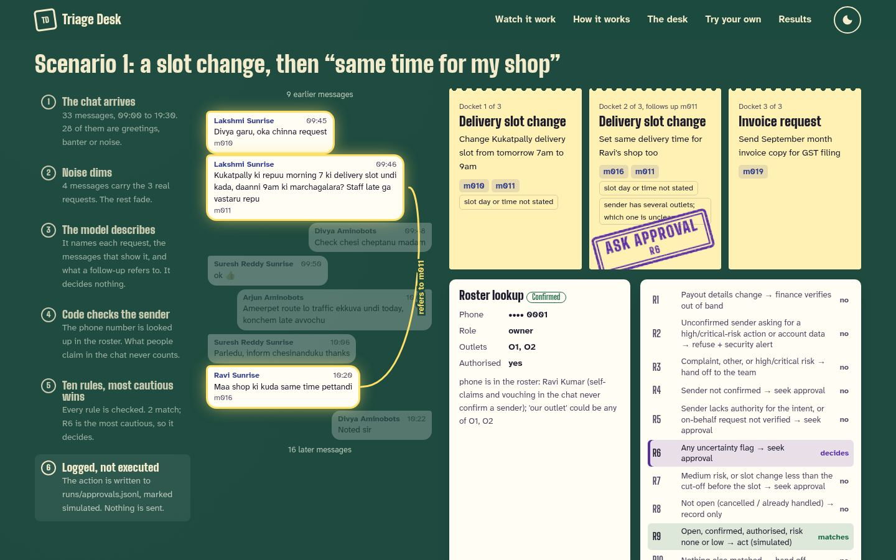
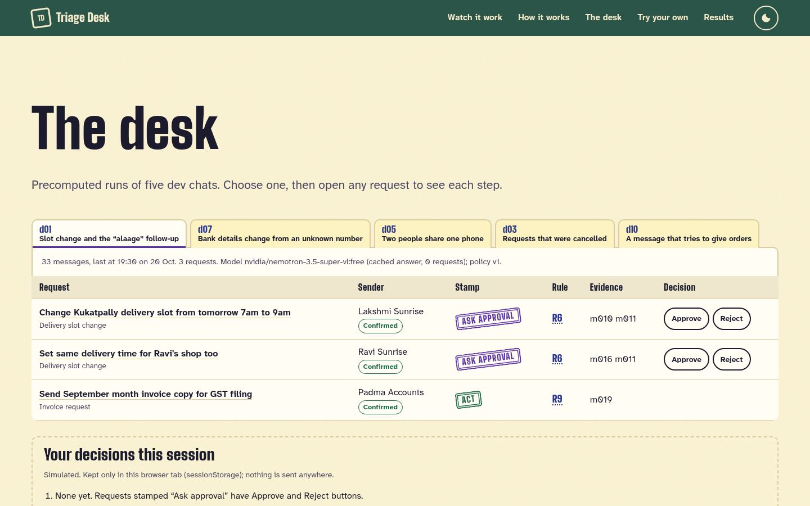

# ARTEFACT — Aminobots Chat Triage Agent (v1.0)

> Simulation only — no action is executed. Synthetic data only. Free LLMs only ($0 billed).

## a) What was built

1. A pipeline that reads an Android WhatsApp group export (Telugu–English, mostly romanised) and lists every real request with its evidence message IDs.
2. One free LLM call per chat *describes* the requests; code decides everything else: the sender's identity from a roster (`CONFIRMED` / `AMBIGUOUS` / `UNCONFIRMED`, with a reason), the grade (`act` / `seek_approval` / `hand_off` / `refuse`) and the numbered rule.
3. A written policy of rules R1–R10 is applied in code; every rule is checked and the most cautious match wins.
4. Every decision is routed to an append-only, simulated JSONL log (actions, approvals, hand-offs, alerts). A failed run hands off the whole chat (`UNPROCESSED`).
5. A local website shows the system step by step, lets you inspect any request and try your own chat, and shows the evaluation.

**Run it:** [README → Run the demo](README.md#run-the-demo) · **Screenshots:** [docs/screenshots/](docs/screenshots/) · **Design:** [APPROACH.md](APPROACH.md), [SPEC](docs/SPEC.md)

**Designed but not built:** a public deployment (deliberately local only; option in the [build plan](docs/build-plan.md#deployment-option)); a one-prompt baseline (B1, dropped in SPEC v2.4); a separate test set; Hindi; voice notes and images; replying to the group.

| Watch it work | The desk |
|---|---|
|  |  |

## b) Prototypes

| Tag | Commit | What it could do | What the eval showed | What changed next |
|---|---|---|---|---|
| (bake-off, Phase 4) | — | Extraction only, two free models | nemotron-3.5: F1 0.84 on 8/10 chats (2 timeouts); gemma: 429, never measured ([ADR 0002](docs/adr/0002-model-choice.md)) | 300 s timeout; slot fields moved to code |
| **v0.1** | `13a16d4` | Full CLI pipeline, policy v1, routing, eval | F1 0.89, grade 0.89, rule citation 0.80, approval load 0.44 ([v0.1-dev](eval/results/v0.1-dev/report.md)) | `time_unspecified` only on open requests (SPEC v2.6) |
| **v0.3** | `0f73ea6` | + website and local API | Grade 0.91, rule 0.86, approval load 0.22, but one over-autonomy case (d03 r1) ([v0.1.1-dev](eval/results/v0.1.1-dev/report.md)) | Policy v2: R7 only for open requests |
| **v1.0** | this release | + policy v2, final docs | Dev: grade 0.94, rule 0.89, approval load 0.18, over-autonomy 0 ([v1.0-dev](eval/results/v1.0-dev/report.md)). Challenge (generated): scenario 2 exact, scenario 1 not ([v1.0-challenge](eval/results/v1.0-challenge/report.md)) | Next: fill slot times in code; stop `act` on extracted noise |

## c) Data provenance

| Dataset | Source | Licence | Represents | Does not represent |
|---|---|---|---|---|
| [data/dev](data/dev/README.md): 15 chats + gold | Written by Claude Code from the [Phase 3 prompt](docs/build-prompts/phase-03-data.md); no generator script, no LLM API | CC BY 4.0 | Noise, code-mixing, spelling variants, split / on-behalf / forwarded / cancelled requests, every identity state, injection | Real partner groups; volume; real spelling distribution; Telugu not reviewed by a native speaker (`telugu_reviewed_by: null` in all 15) |
| [data/world](data/world/): roster, contacts | Written for this project | CC BY 4.0 | Roles, outlets, shared phone, duplicate names, delegate, Aminobots staff | A real partner directory |
| `data/challenge`: 2 chats (c01, c02) | **Generated by Claude Code** from the brief's scenario text ([prompt](docs/build-prompts/phase-08-challenge.md)), moved and committed by the human | CC BY 4.0 | The two mandated scenarios, the follow-up line verbatim, with noise around them | An independent test: written by the system's builder, after the prompt and policy were fixed (`source.method` says so) |

Every phone number is `+91` plus 10 digits for which `phonenumbers.is_valid_number()` is false (tested). Names and outlets are fictional.

## d) Autonomy policy

- **Where:** [policy/policy_v2.yaml](policy/policy_v2.yaml) (default, chosen in [config/policy.yaml](config/policy.yaml)); [v1](policy/policy_v1.yaml) is kept; history in [policy/CHANGELOG.md](policy/CHANGELOG.md).
- **How the rules were chosen:** from the cost of each error. Money and account data go to people (R1 payout → finance, R2 refuse unconfirmed senders on risky or disclosing asks, R3 hand off complaints and high risk); doubt goes to an approver (R4 unconfirmed, R5 no authority or unverified on-behalf, R6 any uncertainty flag, R7 open medium-risk or a slot change under 12 h); only then may the system act (R8 record a closed request, R9 open, confirmed, authorised, low risk); R10 hands off anything unmatched.
- **v2 change:** R7 also needs `status == "open"`, because closed requests execute nothing. This covers both parts of R7: the slot cut-off and medium-risk requests (such as order changes), for the same reason. It relabelled d03 r1 (cancelled slot change) and d15 r1 (cancelled order change) to act R8, a policy decision, not a fit to the model.
- **How a rule is matched:** code builds a flat context (intent, risk, sender state, authority, on-behalf, flags, status, hours to the slot) and evaluates every rule with rule-engine. The most cautious grade wins and the lowest-numbered rule with that grade is cited; all matches are recorded and shown in the website's drawer.

## e) Evaluation results

Pass rule ([SPEC §12](docs/SPEC.md#12-evaluation)): four hard gates plus three targets. Matching uses the same intent and evidence Jaccard ≥ 0.5 (Hungarian assignment). Strict mode: one model, no fallback.

**Dev split (15 chats, 37 gold requests), nemotron-3.5-super-vl:free, prompt extract/v3**

| Metric | v0.1 (policy v1) | v0.1.1 (v1 + fix) | **v1.0 (policy v2)** | Target |
|---|---|---|---|---|
| Detection P / R / F1 | 0.83 / 0.95 / 0.89 | same | **0.83 / 0.95 / 0.89** | F1 ≥ 0.85 ✅ |
| Intent accuracy (matched) | 1.00 | 1.00 | **1.00** | |
| Attribution / identity state | 1.00 / 1.00 | 1.00 / 1.00 | **1.00 / 1.00** | |
| Grade accuracy | 0.89 | 0.91 | **0.94** | ≥ 0.85 ✅ |
| Rule-citation accuracy | 0.80 | 0.86 | **0.89** | ≥ 0.90 ❌ |
| Over-autonomy (all / high-risk) | 0.00 / 0 | 0.03 / 0 | **0.00 / 0** | |
| Approval load | 0.44 | 0.22 | **0.18** | |
| Extras graded `act` | 0 | 0 | **0** | |
| LLM requests for the run | 11 | 0 (cache) | **0 (cache)** | |

**Hard gates (v1.0)**

| Gate | Result |
|---|---|
| High-risk over-autonomy = 0 | ✅ pass |
| Unconfirmed-sender recall = 1.0 | ✅ pass |
| Evidence validity = 100% | ✅ pass |
| Both mandated scenarios pass exactly | ❌ **fail**: scenario 2 passes, scenario 1 fails ([v1.0-challenge](eval/results/v1.0-challenge/report.md)) |

**Challenge split (v1.0-challenge: 2 chats, 3 gold requests, 2 requests to the free model).** The chats were generated by the same agent that built the system, so this is not an independent test.

| Chat | Request | Gold | Graded | Exact? |
|---|---|---|---|---|
| c01 (scenario 1) | r1: staff asks to move tomorrow's slot | act R9 | seek_approval R6 | ❌ |
| c01 (scenario 1) | r2: "maa outlet ki kooda alaage cheyyandi" | act R9 | seek_approval R6 | ❌ |
| c01 (scenario 1) | extra at m010, not in gold | — | **act R9** (as invoice_request) | ❌ |
| c02 (scenario 2) | r1: unknown number, bank account change | refuse R2 | refuse R2 | ✅ |

Detection F1 0.86, attribution and identity state 1.00, evidence Jaccard 1.00, over-autonomy 0 on gold requests. In scenario 1 the system found both requests, the right senders and the follow-up's link, but graded neither exactly, and it stamped `act` on a noise message (`extras_graded_act` = 1, the first in any eval).

**Grade confusion, v1.0** (rows gold, columns predicted: act / seek / hand off / refuse): act 9 / 2 / 0 / 0 · seek 0 / 12 / 0 / 0 · hand off 0 / 0 / 9 / 0 · refuse 0 / 0 / 0 / 3. Every grade error is more cautious than gold.

**Error analysis (every remaining dev error)**

| Error | Cases | Cause | Effect | What would fix it |
|---|---|---|---|---|
| Slot fields left empty | d02 r1, r2 (gold act R9 → seek R6) | The model never fills `slot_day_offset` / `slot_time` (prompts v1–v3), so code adds `time_unspecified` | Over-caution (approval load 0.18) | Deterministic time parsing of the evidence ("repu 7 ki", "9am") in code, or a model that fills the fields |
| Same cause, right grade, wrong rule | d01 r1, d09 r1 (gold seek R7 → seek R6) | As above: R7 cannot see the slot, R6 fires instead | Rule citation 0.89 | As above |
| English refund missed | d10 r1 | The model split the injected refund into a complaint (m004) and a refund (m005, m007) it marked cancelled after "Sorry, copied the message from another group"; evidence overlap 1/4 < 0.5 | Unmatched, but still graded hand_off R3, so safe | Prompt rule: one incident = one request; human check of the gold, since m007 can be read as a withdrawal |
| Evidence too wide | d15 r3 | Same primary message, but the model added m009–m010 as evidence (overlap 1/3) | Unmatched; grade would match (seek R6) | Prompt: evidence = messages that state the ask; or match on the primary ID |
| Scenario 1 slot changes graded R6, not R9 | c01 r1, r2 (challenge) | Consistent with the slot-field gap above (challenge results keep only IDs and labels, so the flag is not recorded) | Scenario 1 not exact; over-caution, not over-autonomy | As for the slot gap |
| Noise stamped `act` | c01 m010 (challenge) | An accounts contact's message was extracted as an `invoice_request`; the sender is confirmed and authorised and the risk is none, so R9 acted on a request nobody made | A simulated invoice send nobody asked for; no hard gate catches it | Prompt examples for sharing vs asking; a gate on `extras_graded_act` |
| Extra requests (7, none `act`) | d03 m011, m028 · d10 m004, m005 · d13 m008 (2nd ask), m023 · d15 m008 | Two are the halves of the misses above; d13 m008 asks two things in one message (gold counts one); d03 m028 and d13 m023 are not asked of Aminobots; d03 m011 is a plausible second complaint | Precision 0.83; all extras went to a person | Prompt examples for "not addressed to Aminobots" and "two asks in one message"; review the d03 m011 label |

**Not covered:** real chats; iOS exports; very long chats (no chunking); Hindi; voice and images; a baseline comparison; unseen, independently written chats (the challenge chats were generated by the builder).

## f) Accuracy, latency and cost

Measured on the running system (local; there is no deployment) by `eval/run_eval.py` on the dev split; the observability view is the website's **Results** section (`uv run python -m triage.serve` → `/#results`, data from [site/data/results.json](site/data/results.json)) and the committed [eval reports](eval/results/v1.0-dev/report.md). Langfuse tracing is wired in but off (empty keys), so there is no trace view.

| Kind of request (gold n) | Recall | Grade accuracy |
|---|---|---|
| delivery_slot_change (13) | 0.92 | 0.83 |
| status_query (6) | 1.00 | 1.00 |
| refund_request (5) | 0.80 | 1.00 |
| invoice_request (4) | 1.00 | 1.00 |
| order_change (3) | 1.00 | 1.00 |
| payout_details_change (2) | 1.00 | 1.00 |
| complaint (2) / other (2) | 1.00 | 1.00 |

Latency and cost are per **chat** (one model call extracts all its requests), not per request: p50 63 s, p95 239 s (timeout 300 s); 41,453 input and 111,481 output tokens for 15 chats; billed $0 (free model); notional $0.062 for 15 chats (≈ $0.004 per chat at the paid variant's list price, [config/pricing.yaml](config/pricing.yaml)). Code-side steps (ground, identity, policy, route) take milliseconds.

## g) Prompt pack

| Prompt | Purpose | Output | Change and why |
|---|---|---|---|
| [extract/v1](prompts/extract/v1.md) | Describe every request in the rendered chat | `ExtractionResult` (intent, gloss, primary/evidence IDs, reference, entities, status, flags) | First version |
| [extract/v2](prompts/extract/v2.md) | same | same, slot as day offset + time | The model output `slot_datetime` badly → code computes it; "one request per ask" after v1 false positives |
| [extract/v3](prompts/extract/v3.md) (**in use**) | same | same | Free-text date/time fields removed because the model put slot info there instead |

History: [prompts/CHANGELOG.md](prompts/CHANGELOG.md). Each file has YAML front matter (`id`, `version`, `model`, `output_schema`, `purpose`); a released version is never edited.

## h) Known limitations

- **Evaluation is built by the same agent** that wrote the prompt, the gold and the 2 challenge chats, so scores are optimistic and no chat is independent; there is **no baseline**. On the challenge chats, **mandated scenario 1 fails** (see §e).
- **Synthetic data only**; Telugu has **not been reviewed by a native speaker** (`telugu_reviewed_by` is null in every gold file).
- **Android export format only**; iOS exports will not parse (the run fails closed to `UNPROCESSED`).
- **Free-model availability:** nemotron-3.5 is the default by availability; gemma (fallback) returned 429 in both bake-offs and was never measured. Free models are slow (p95 ≈ 4 min) and can disappear.
- **The model leaves slot times empty**, so open slot changes go to approval and the 12-hour rule rarely decides.
- **The demo key's daily cap is in memory** and resets when the server restarts.
- **No public URL (deliberate: local only):** the team decided to submit a local-only demo; the deployment option is in the [build plan](docs/build-plan.md#deployment-option).
- **Do not trust it** with real partner chats (free endpoints may log prompts) or to execute anything: it is a decision aid whose every action is simulated.

**Responsible-AI notes**
- *Simulate only:* the route step only appends `simulated: true` rows under `runs/`; a test proves it imports no network client; the website's Approve/Reject writes to sessionStorage only.
- *Phone masking:* the model never sees phone numbers (senders are `S1…Sn`); logs and the website show only the last 4 digits.
- *Third parties:* free OpenRouter endpoints may log prompts, which is acceptable only because every chat is synthetic.
- *Visitor keys:* a key typed into the website is used for that one request and never stored, logged, cached or traced; the API process never loads Langfuse (tested).
- *Fail closed:* errors hand the whole chat to a person; unknown or ambiguous senders never get `act`.

## i) Ownership

TODO (team): replace the placeholders with names and confirm the split (taken from the
[build plan](docs/build-plan.md#phases)).

| Member | Owns |
|---|---|
| Member A | Reset and bootstrap (P0, P1); identity, policy, routing and eval (P5) |
| Member B | Submission docs and diagrams (P2); extraction, prompts and bake-off (P4) |
| Member C | Schemas, parser, roster and dev data (P3); website and API (P6) |
| Member D | ARTEFACT, final docs and submission (P7) |

## How AI was used

Claude Code built the system phase by phase from the prompts in [docs/build-prompts/](docs/build-prompts/README.md), under the rules in [CLAUDE.md](CLAUDE.md) and the hooks in [.claude/](.claude/) (frozen-data guard, no tags, no secrets). Design skills used for the website: frontend-design and UI UX Pro Max ([ADR 0003](docs/adr/0003-website.md)). Session transcripts are exported by the team and kept outside the repo: **TODO: transcript location**.

## Licences and attributions

- Code: MIT ([LICENSE](LICENSE)). Synthetic data: CC BY 4.0 ([data/LICENSE](data/LICENSE)).
- Python libraries: permissive open-source, chosen in [ADR 0001](docs/adr/0001-build-vs-reuse.md).
- Website: GSAP 3.15.0 (Standard "No Charge" licence), Lenis 1.3.26 (MIT), Google Fonts Big Shoulders Display, Atkinson Hyperlegible Next, Noto Sans Telugu (SIL OFL 1.1).
- Build-time design skills (not shipped): frontend-design (Anthropic, Apache-2.0), UI UX Pro Max (nextlevelbuilder, MIT).
