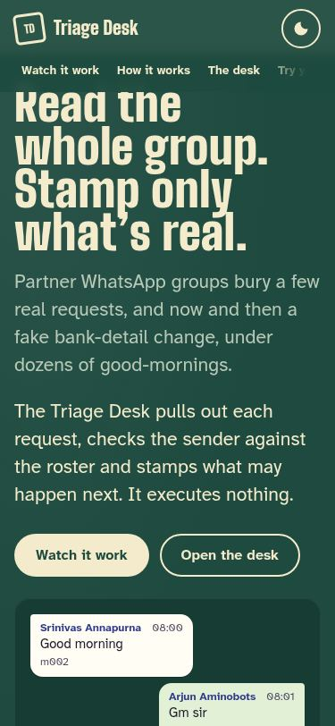

# Aminobots Chat Triage Agent

Reads a WhatsApp partner group chat (Telugu–English, mostly romanised) and lists every real
request. Each request shows who asked and whether that is confirmed, a grade (act / seek approval /
hand off / refuse), the numbered rule behind the grade, and the messages it relied on.

> Simulation only — no action is executed. Synthetic data only. Free LLMs only ($0).

**Status:** Phase 6: pipeline, evaluation and the local website (v0.3 candidate). The first attempt
is preserved on the `archive/first-attempt` branch.

## Docs

- [APPROACH.md](APPROACH.md): problem scoping, system design, data, evaluation, risks
- Diagrams: [architecture](docs/architecture.drawio.svg) · [workflow](docs/workflow.drawio.svg)
  (editable in diagrams.net; regenerate with `uv run python scripts/make_diagrams.py`)
- [Build plan](docs/build-plan.md): phases, request budget, risks
- [Functional document](docs/functional.md): problem, current process, interventions, user
  journey, tech construct
- [SPEC v2](docs/SPEC.md): contracts, policy, evaluation
- [Project context](docs/context/PROJECT_CONTEXT.md): decisions and the original brief
- [CLAUDE.md](CLAUDE.md): rules for the coding agent
- [ADRs](docs/adr/): build-vs-reuse decisions
- [Website design brief](docs/design/brief.md) and [self-review](docs/design/review.md)
- [Build prompts](docs/build-prompts/): how the project was built, phase by phase

## Run the demo

```
git clone https://github.com/Anish-185/aminobots-chat-triage-agent.git
cd aminobots-chat-triage-agent
uv sync
cp .env.example .env              # optional: fill OPENROUTER_API_KEY locally; never commit it
uv run python -m triage.serve     # → http://127.0.0.1:8000/
```

The story, the desk and the results run from precomputed pipeline output in `site/data/`, so
they need no key and make no LLM call. **Try your own** sends a chat to the local API, which runs
the real pipeline with the free model in `config/models.yaml`. It uses your `.env` key (capped at
10 new requests a day), or a key typed into the page, which is used once and never stored, logged
or traced. Rebuild the site data from the cache with `uv run python scripts/build_site_data.py`.

| Watch it work | The desk | Phone |
|---|---|---|
|  |  |  |

Other commands:

```
uv run pytest                                          # unit tests, no API calls
uv run python -m triage.cli run data/dev/d01.txt       # one chat in the terminal
uv run python -m eval.run_eval --split dev --tag <tag> # eval (cached answers cost nothing)
```

## Licence

Code: MIT ([LICENSE](LICENSE)). Synthetic data: CC BY 4.0 ([data/LICENSE](data/LICENSE)).
