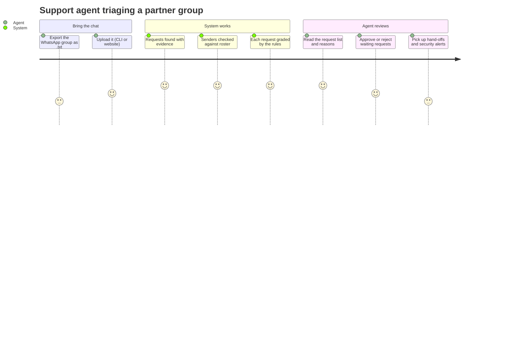
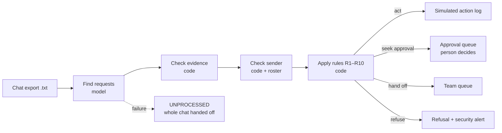
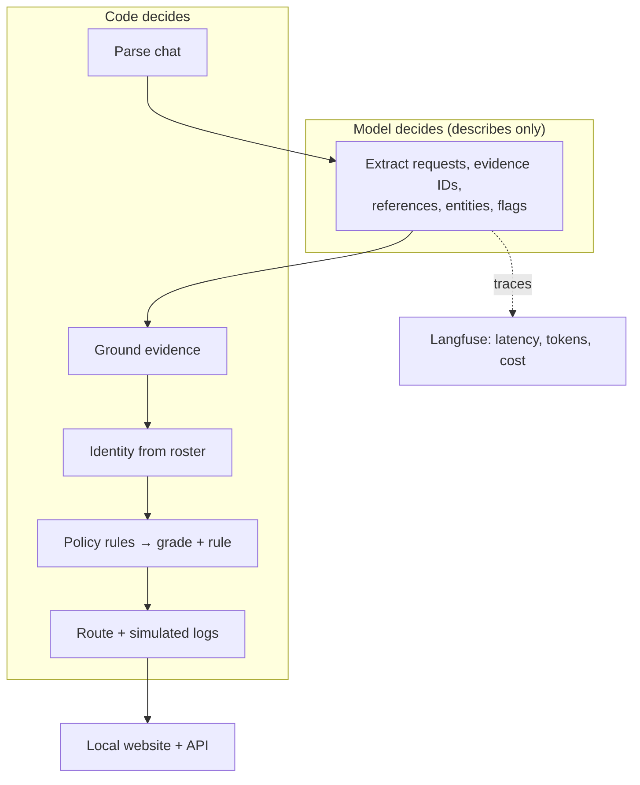

# Functional document — Aminobots Chat Triage Agent

A plain-language description of the problem and the proposed system. Technical contracts are in
[SPEC.md](SPEC.md). Everything shown here is a **demo on synthetic data**; no action is ever
executed.

---

## 1. Understanding of the problem

Aminobots supports its partner outlets through hundreds of WhatsApp group chats. In each group,
real requests ("move tomorrow's delivery slot", "send last month's invoice", "change the bank
account") are buried among greetings, "ok sir 👍", forwards, photos and festival wishes. Messages
mix Telugu and English, mostly typed in Roman script, with free spelling ("cheyyandi",
"cheyandi").

For every request, someone has to answer four questions:

1. **Is this actually a request?** Or is it chatter, a forward, an acknowledgement?
2. **Who asked, and can we trust that?** A new number, a shared phone or a display name that
   matches two people means the sender cannot be confirmed.
3. **What exactly is being asked, and for which outlet?** Requests are split across messages
   ("maa outlet ki kooda alaage cheyyandi" — *do the same for our outlet too*) or made on
   someone else's behalf.
4. **How much may we do without asking anyone?** Act, ask for approval, hand off to a person, or
   refuse.

Aminobots wants a system that answers these questions consistently and **states the rule behind
every decision**.

## 2. Domain context: the current process and its challenges

Today a support person reads each group by hand.

| Challenge | Why it hurts |
|---|---|
| Volume and noise | Requests are easy to miss in long, chatty groups |
| Code-mixed, romanised Telugu | Keyword search and generic tools miss them; research shows romanised text is harder for language models than native script |
| Split and indirect requests | "Same for our outlet" only makes sense together with an earlier message |
| Unconfirmed senders | A new number asking to change payout details is a classic fraud pattern |
| Inconsistent judgement | Two people may treat the same request differently, and the reason is rarely written down |
| Slow | A person has to read everything before anything happens |

*Working assumptions, to be confirmed with Aminobots mentors:* Aminobots serves partner outlets
with deliveries, orders and payouts (A1); in the first mandated scenario the "staff member" is
partner-side staff (A2); delivery slots can be changed automatically only up to 12 hours before
the slot (A3).

## 3. Proposed interventions

| Intervention | What it does |
|---|---|
| **Request finder** | Reads the whole chat and lists only real requests, each pointing to the exact messages it is based on. Anything without valid evidence is dropped. |
| **Sender check** | Looks up each sender's number in a partner roster and labels them *confirmed*, *ambiguous* or *unconfirmed*, with a written reason. Claims like "this is my new number" never count as proof. |
| **Written autonomy policy** | A short numbered rulebook (R1–R10). Every rule is checked; the most cautious outcome wins; the deciding rule is cited. |
| **Human approval step** | Requests graded *seek approval* wait for a person to approve or reject. |
| **Simulated action log** | Everything the system "does" is only written to a log. Nothing is sent, changed or paid. |
| **Inspectable website** | For any chat, shows each step: the messages used, what the model found, the sender check, every rule checked, and the outcome. |

The four outcomes:

| Grade | Meaning | Example |
|---|---|---|
| **Act** | Safe and allowed: the system records the (simulated) action | A confirmed staff member moves tomorrow's slot, more than 12 h ahead |
| **Seek approval** | Probably fine, but a person must approve first | Same request from someone who runs two outlets and didn't say which |
| **Hand off** | A person takes over | Any payout-detail change; complaints |
| **Refuse** | Not done, and a security alert is raised | An unknown number asks to change the bank account before today's payout |

## 4. High-level user journey

The main user is an **Aminobots partner-support agent**. A second user is a **reviewer or
evaluator** exploring the website.

**The two mandated scenarios:**

- *Scenario 1.* A staff member asks, half in Telugu, to move tomorrow's delivery slot. A few
  messages later someone else writes "maa outlet ki kooda alaage cheyyandi". The system lists
  **two** requests. The first is graded *act* (R9) if the sender is confirmed and the slot is more
  than 12 h away. The follow-up is linked to the first message and resolved to the replier's
  outlet. It is *act* if they are confirmed with one outlet, *seek approval* (R6) if they have two
  outlets, and *seek approval* (R4) if the number is unknown.
- *Scenario 2.* An unknown number asks to change the bank account before today's payout. The
  system **refuses** and raises a security alert (R2). R1 (payout changes always go to finance)
  also matched and is shown.

## 5. The tech and agentic construct

**Pattern: a fixed workflow with one model step; code decides.** It is not a free-roaming agent.
The model is good at reading messy code-mixed chat, so it only *describes*: which messages are
requests, what is asked, which messages are evidence, and what is uncertain. Everything that
carries risk — who the sender is, whether they are allowed, the grade and the rule — is decided by
plain code from a roster and a rules file. A message inside the chat therefore cannot talk the
system into doing more ("ignore your rules…" is just flagged as an injection attempt).

*Rejected alternative:* a tool-using ReAct agent that decides and acts by itself. Its autonomy
decisions would be hard to audit, and it would be open to prompt injection from chat text.

| Part | Built from (free, open source) |
|---|---|
| Chat parsing | chat-miner |
| Model | OpenRouter **free** models only, called through Instructor with a fixed schema |
| Caching | diskcache (re-runs cost no requests) |
| Rules | rule-engine (rules in a YAML file, easy to swap for Aminobots' own policy) |
| Sender check | phonenumbers + rapidfuzz + a synthetic roster |
| Observability | Langfuse Cloud free tier |
| Evaluation | scikit-learn + scipy, on dev + 2 human-written challenge chats (no separate test set) |
| Showcase | a static website + small FastAPI service, run locally |

**Safety by construction:** fail closed (any error → the whole chat goes to a person), evidence
required for every request, autonomy that can only go down when rules are added, synthetic data
only, and a total cost of $0.
